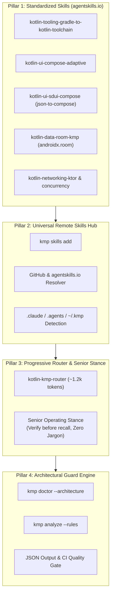

# RFC-004: Agent Skills Evolution, Universal Hub, and Architectural Guard Engine

> **Status:** Accepted  
> **Author:** Jesús Daniel Medina Cruz ([github.com/jesusdmedinac](https://github.com/jesusdmedinac))  
> **Date:** October 11, 2026  
> **Inspiration & Ecosystem References:**  
> - [`Kotlin/kotlin-agent-skills`](https://github.com/Kotlin/kotlin-agent-skills) (JetBrains Official `agentskills.io` Standard)  
> - [`Meet-Miyani/compose-skill`](https://github.com/Meet-Miyani/compose-skill) (Avinya Compose Kit & Guard Scripts)  
> - [`kmp-cli`](https://github.com/jesusdmedinac/kmp-cli)

---

## 1. Context & Motivation

Kotlin Multiplatform development has crossed a major threshold: AI coding agents (Claude Code, Cursor, Codex, Antigravity) are now writing production code alongside humans. However, the ecosystem was divided into two isolated silos:

1. **JetBrains Official (`Kotlin/kotlin-agent-skills`):** Heavily focused on compiler tooling, migration from Gradle to the declarative **Kotlin Toolchain (`module.yaml`)**, CocoaPods to SPM, and Java-to-Kotlin. Lacks mobile UI, Compose, and application architecture guidelines.
2. **Community Standards (`Meet-Miyani/compose-skill`):** Exceptional at Jetpack Compose/CMP UI, Navigation 3, and MVI `BaseViewModel` architecture, backed by CI guard scripts. However, it remains tethered to legacy Gradle convention plugins and ignores the official Kotlin Toolchain.

**KMP CLI** bridges these worlds into a unified developer experience and agent orchestration engine.

---

## 2. The 4 Evolution Pillars

---

## 3. Detailed Specification

### Pillar 1: Standardized Skills & Room KMP
* Rename all local seed skills in `skills/catalog.json` to follow `kotlin-<category>-<functional-name>`:
  - `kotlin-tooling-gradle-to-kotlin-toolchain` (Tooling)
  - `kotlin-ui-compose-adaptive` (UI)
  - `kotlin-ui-sdui-compose` (UI / SDUI)
  - `kotlin-data-room-kmp` (Data / Room 2.7.0+)
  - `kotlin-networking-ktor` (Networking)
  - `kotlin-concurrency-coroutines` (Concurrency)
* Maintain legacy aliases (`kmp-*`) in the CLI for seamless backwards compatibility.

### Pillar 2: Universal Remote Skills Hub
* Extend `kmp skills add` to support remote GitHub coordinates:
  - `kmp skills add Kotlin/kotlin-agent-skills`
  - `kmp skills add Meet-Miyani/compose-skill:compose-architecture`
* Auto-detect destination paths:
  - `.claude/skills/` (Claude Code)
  - `.agents/skills/` (Antigravity / Cursor)
  - `~/.kmp/skills/` (Global CLI fallback)

### Pillar 3: Progressive Router & Senior Operating Stance
* Introduce `kotlin-kmp-router` entry skill:
  - Evaluates intent: *New feature*, *Bug fix*, *Migration*, *Refactor*, *Review*.
  - Dynamically loads only the affected 1–2 skill files.
* Codify the Senior Staff Stance:
  - *Verify before recall*: Never invent APIs or Gradle coordinates.
  - *Say no when the answer is no*: Reject shortcuts that damage maintainability.
  - *Zero UI Jargon*: Prohibit technical terms ("Room", "KMP", "json-to-compose") in customer-facing screens.

### Pillar 4: Architectural Guard Engine
* Add `--architecture` flag to `kmp doctor`:
  - Static AST/regex inspection of Kotlin source files.
  - Check 1: Presentation files importing Data/DAO implementations.
  - Check 2: ViewModels exposing `MutableStateFlow`.
  - Check 3: Domain layer dependencies on UI or Android SDK.
  - Check 4: `module.yaml` dependency sync with actual imports.
* Output rich ANSI report for human developers and `--json` for CI/CD gates.
