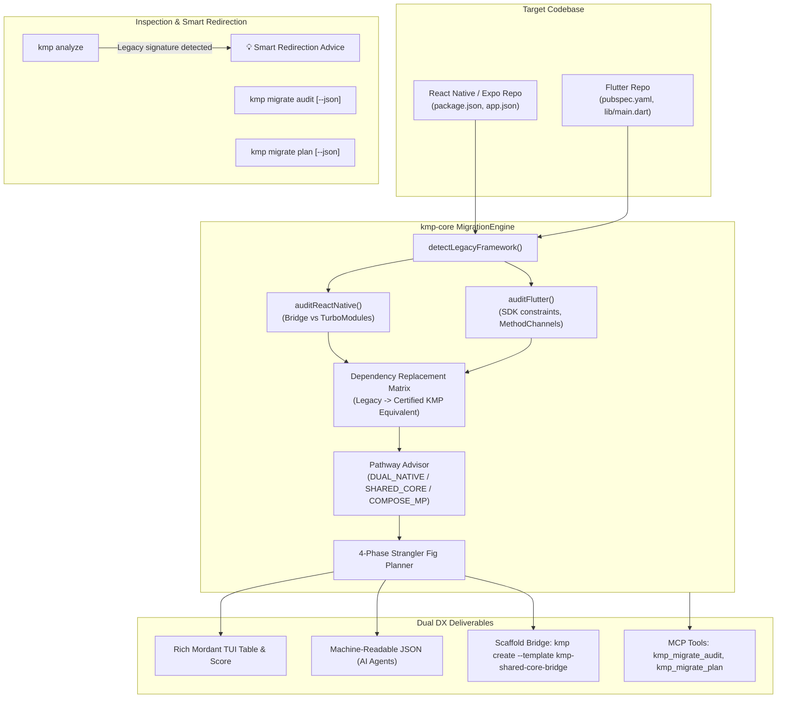

# RFC-005: Cross-Platform Modernization & Migration Engine (`kmp migrate`)

> **Status:** Accepted (Implemented in PR #49)  
> **Authors:** Jesús Daniel Medina Cruz & Antigravity AI Pair  
> **Date:** October 2026  
> **Target Feature Specification:** [`docs/features/07_cross_platform_modernization_and_migration.feature`](features/07_cross_platform_modernization_and_migration.feature)  
> **Canonical Upstream Baseline References:**  
> - [React Native Environment Setup & Expo Framework Guide](https://reactnative.dev/docs/environment-setup)  
> - [Flutter Set Up & Test Drive Guide](https://docs.flutter.dev/install/quick)  

---

## 1. Context & Motivation

Engineering organizations that initially built mobile apps in cross-platform runtimes (React Native, Flutter) face strategic architectural inflection points as their products mature:
- **Performance & Native Bridge Friction:** Legacy JavaScript asynchronous JSON bridges introduce frame-rate drops, garbage collection pauses, and serialization overhead under heavy UI workloads.
- **Platform Divergence:** High-fidelity native features (Apple Watch, Dynamic Island, Widgets, HealthKit, CameraX, Android Automotive) require deep native bindings that fight against cross-platform abstractions.
- **Developer Velocity vs Architecture Purity:** Teams seeking uncompromised native user experiences want a path to share business logic, offline databases, and networking via **Kotlin Multiplatform (KMP)** without undertaking risky, high-cost "big bang" rewrites.

To solve this, **KMP CLI** introduces the **Cross-Platform Modernization & Migration Engine (`kmp migrate`)**, empowering mobile tech leads, architects, and AI coding agents to evaluate legacy codebases and execute safe, phased **Strangler Fig migrations**.

---

## 2. Canonical Upstream Framework Baselines

To ensure accuracy when auditing real-world projects, the engine grounds its detection and dependency replacement matrices directly against the official starter standards established by Meta and Google:

```
┌──────────────────────────────────────────────────────────────────────────┐
│              Official Canonical Cross-Platform Baselines                 │
├─────────────────────────────────────┬────────────────────────────────────┤
│ React Native (Meta Standard)        │ Flutter (Google Standard)          │
│ https://reactnative.dev/docs/       │ https://docs.flutter.dev/          │
│ environment-setup                   │ install/quick                      │
├─────────────────────────────────────┼────────────────────────────────────┤
│ • Canonical Tool: Expo Framework    │ • Canonical Tool: Flutter CLI /    │
│   `npx create-expo-app@latest`      │   VS Code Application Template     │
│ • Architecture: TurboModules /      │ • Architecture: Impeller / Skia    │
│   Fabric (New Architecture default) │   Engine with MethodChannels       │
│ • Descriptor: package.json, app.json│ • Descriptor: pubspec.yaml         │
│ • Routing: expo-router file routes  │ • Routing: GoRouter / Navigator    │
│ • Native Layer: Prebuild / CNG      │ • Native Layer: Fixed platform     │
│   (Continuous Native Generation)    │   directories (android/, ios/)     │
└─────────────────────────────────────┴────────────────────────────────────┘
```

---

## 3. Architecture Overview



---

## 4. Architectural Modernization Pathways

The feasibility engine evaluates platform targets, native bridge complexity, and team structure to recommend one of three canonical pathways:

| Modernization Pathway | Target Criteria | Recommended Architecture & Rationale |
| :--- | :--- | :--- |
| **`DUAL_NATIVE`** | Heavy OS-specific UI, complex AR/camera, divergent platform design systems. | **100% SwiftUI + 100% Jetpack Compose**: Uncompromised native platform fidelity with zero bridge overhead. |
| **`NATIVE_UI_SHARED_CORE`** | Rich existing design systems, platform-specific UX, shared business logic and offline state. | **Native UI + Shared KMP Core**: Native iOS/Android presentation consuming a shared Kotlin Multiplatform library via SKIE and SPM/AAR. |
| **`COMPOSE_MULTIPLATFORM`** | High UI consistency requirement, velocity focus, unified multiplatform team. | **100% Compose Multiplatform**: Unified declarative UI codebase shared across Android, iOS, Desktop, and Web. |

---

## 5. Phased Strangler Fig Migration Roadmap

Rather than risky "big bang" rewrites, the engine produces an incremental, step-by-step roadmap:

### Phase 1: Foundation & Core Bridge
- Setup shared KMP library skeleton using `kmp create --template kmp-shared-core-bridge`.
- Export CocoaPods / Swift Package Manager (SPM) framework for iOS and Maven Local / AAR for Android.
- Unify networking (`kotlin-networking-ktor`) and authentication in `commonMain`; consume from existing legacy shell.

### Phase 2: Domain & Data Strangler
- Migrate local persistence (`kotlin-data-room-kmp` or `kotlin-data-sqldelight-database`) into shared KMP module.
- Unify offline repository and reactive caching with Store5 (`kotlin-data-store5`).
- Strangle legacy mobile state stores (Redux / BLoC) by observing KMP `StateFlow`.

### Phase 3: UI & Screen Incremental
- Replace high-friction or performance-critical legacy screens with Compose Multiplatform or native UI.
- Embed `ComposeView` on Android and `ComposeUIViewController` on iOS inside the legacy navigation shell.
- Migrate design tokens and theme palettes to shared Compose Multiplatform theme (`kotlin-ui-compose-adaptive`).

### Phase 4: Legacy Shell Deletion
- Replace root application entry point with native Kotlin/Compose `MainActivity` and iOS `MainViewController`.
- Remove JavaScript / Dart runtime engines, `node_modules`, and bridge pods.
- Finalize standalone multiplatform binary compilation with sub-second startup times.

---

## 6. Curated Skills & Scaffolding Template

The migration feature contributes 3 canonical skills to the KMP Skills Hub:
1. **[`kmp-migrate-from-react-native`](../../skills/kmp-migrate-from-react-native/SKILL.md):** Strangler migration patterns, bridge elimination, JS state to Kotlin `StateFlow`.
2. **[`kmp-migrate-from-flutter`](../../skills/kmp-migrate-from-flutter/SKILL.md):** Flutter Widget & BLoC migration to Compose Multiplatform & Coroutines.
3. **[`kmp-shared-core-bridge`](../../skills/kmp-shared-core-bridge/SKILL.md):** Architecture and packaging of a Shared KMP Core for existing native shells.

And the starter template:
- **`kmp-shared-core-bridge`:** A pre-configured multiplatform library exporting iOS frameworks (SPM/CocoaPods) and Android AARs with Touchlab SKIE coroutines bridge and common dispatchers.
