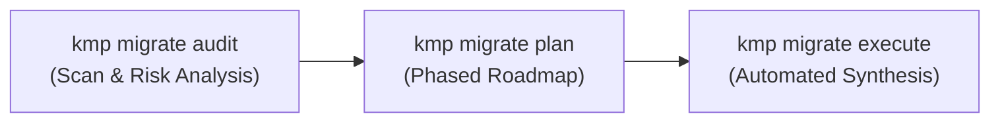

# `kmp migrate`

Modernize legacy cross-platform codebases (React Native, Flutter) into production-grade Kotlin Multiplatform applications using an automated **Strangler Fig** methodology.

---

## The 3-Step Migration Lifecycle



---

## 1. `kmp migrate audit`

Scans a legacy project directory, identifies framework versions, architecture bottlenecks (e.g. legacy JS bridge vs TurboModules, Flutter Platform Channels), and computes a multiplatform compatibility score:

```bash
kmp migrate audit path/to/legacy-app
```

Output highlights:
- Detected framework: `REACT_NATIVE` or `FLUTTER`.
- Architecture type: `OLD_BRIDGE`, `NEW_ARCHITECTURE_TURBOMODULES`, `FLUTTER_PLATFORM_CHANNELS`.
- Detected platform targets: `android`, `ios`, `web`, `windows`, `macos`.
- Dependency replacement matrix (e.g., `axios` -> `Ktor`, `AsyncStorage` -> `Multiplatform-Settings`).
- Recommended modernization pathway: `COMPOSE_MULTIPLATFORM`, `NATIVE_UI_SHARED_CORE`, or `DUAL_NATIVE`.

---

## 2. `kmp migrate plan`

Generates an incremental Strangler Fig modernization roadmap dividing the migration into risk-controlled phases:

```bash
kmp migrate plan path/to/legacy-app
```

Roadmap Phases:
- **Phase 1: Living Foundation & Core Domain**
- **Phase 2: Networking & Shared Data Sync**
- **Phase 3: State Management & ViewModels**
- **Phase 4: UI Modernization & Edge-to-Edge Design**

---

## 3. `kmp migrate execute`

Synthesizes the new Kotlin Multiplatform target project:

```bash
kmp migrate execute path/to/legacy-app -o path/to/destination-kmp -p com.example.migrated
```

### Options
- `-o`, `--output`: Output directory for the new KMP project.
- `-p`, `--package`: Application package / namespace ID.
- `--strategy`: `autonomous` (default) or `guided`.
- `--pathway`: Override pathway (`compose-multiplatform`, `native-ui-shared-core`, `dual-native`).
- `--json`: Output execution summary as JSON.

### Execution Deliverables
1. **Foundation Scaffolding**: Gradle multiplatform build scripts, active runners (`:androidApp`, `iosApp`).
2. **Layer 1 (Domain Models)**: Type-safe Kotlin data classes.
3. **Layer 2 (Data & Networking)**: Ktor 3 and Multiplatform-Settings integration.
4. **Layer 3 (State Management)**: Shared `StateFlow` ViewModels with Koin DI.
5. **Layer 4 (UI & Assets)**: Compose Multiplatform screens with density-routed assets (`drawable/`, `drawable-xhdpi/`).
6. **Living Progress Tracker**: Auto-generates `MIGRATION_PROGRESS.md` in the destination project.
