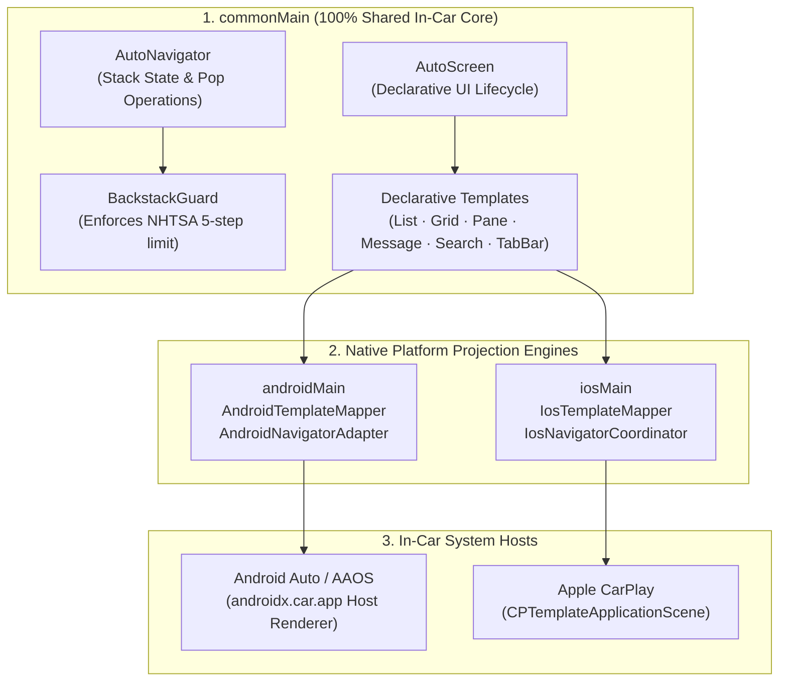
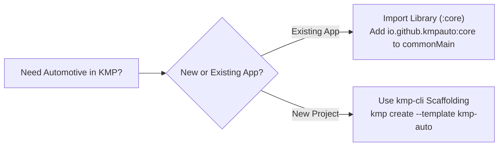

# `kmp-auto`

**The Unified In-Car Automotive Framework for Android Auto, Android Automotive OS & Apple CarPlay in Kotlin Multiplatform.**

<p align="left">
  <a href="https://github.com/jesusdmedinac/kmp-auto"></a>
  <a href="https://kotlinlang.org/docs/multiplatform.html"></a>
  <a href="https://developer.android.com/training/cars/apps"></a>
  <a href="https://developer.apple.com/carplay/"></a>
  
</p>

---

## Overview

Automotive application development differs fundamentally from standard mobile UI development: **vehicle head units do not render arbitrary canvas or freeform views**. Due to strict driver distraction regulations established by the **NHTSA (National Highway Traffic Safety Administration)** and vehicle manufacturers, both Google and Apple mandate **host-rendered, template-based architectures**:

* **Android Auto & Android Automotive OS (AAOS)**: All in-car screens must be expressed through `androidx.car.app` declarative templates (`ListTemplate`, `PaneTemplate`, `GridTemplate`, `MessageTemplate`, `SearchTemplate`), rendered by the car's system host (`com.google.android.apps.automotive.templates.host`).
* **Apple CarPlay**: All in-car views must conform to `platform.CarPlay` template hierarchies (`CPListTemplate`, `CPInformationTemplate`, `CPGridTemplate`, `CPAlertTemplate`, `CPSearchTemplate`), managed through a `CPInterfaceController` within a `CPTemplateApplicationScene`.

Traditionally, mobile engineering teams had to design, implement, and maintain **two completely isolated native automotive codebases**. Despite the conceptual models being virtually identical, zero navigation logic, backstack safety handling, or reactive state flows could be shared across platforms.

**`kmp-auto` solves this fragmentation**: it provides a unified, declarative in-car architecture in `commonMain` that projects symmetrically to native Android Auto and Apple CarPlay surfaces at runtime.

---

## Architectural Flywheel



### Core Design Directives

1. **Strict Multiplatform Boundary Hygiene**: `commonMain` contains zero imports from `android.*` or `platform.CarPlay.*`. Platform engines operate strictly as reactive projection mappers.
2. **Backstack Safety Engine (`BackstackGuard`)**: Automotive displays enforce strict navigation depth limits (typically 5 screens). Exceeding this limit causes immediate runtime crashes or host rejection. `BackstackGuard` automatically intercepts deep pushes with configurable policies (`REPLACE_TOP`, `THROW_EXCEPTION`, `IGNORE`).
3. **Reactive Invalidation Pipeline**: In-car screens declare reactive dependencies using Kotlin Coroutines `StateFlow`. When internal screen state updates, `kmp-auto` automatically triggers `screen.invalidate()` on Android Auto and `updateSections()` on CarPlay.

---

## Template Equivalency Matrix

`kmp-auto` bridges every official in-car template symmetrically between Android Auto and Apple CarPlay:

| `kmp-auto` Template (`commonMain`) | Android Auto / AAOS (`androidx.car.app`) | Apple CarPlay (`platform.CarPlay`) | In-Car Use Cases |
| :--- | :--- | :--- | :--- |
| **`AutoListTemplate`** | `ListTemplate` | `CPListTemplate` | POI directories, charging stations, playlists, transaction history |
| **`AutoGridTemplate`** | `GridTemplate` | `CPGridTemplate` | Quick controls, drive modes, climate shortcuts, media categories (max 8 buttons) |
| **`AutoPaneTemplate`** | `PaneTemplate` | `CPInformationTemplate` | Vehicle diagnostics, battery status, order summaries + action buttons |
| **`AutoMessageTemplate`** | `MessageTemplate` | `CPAlertTemplate` | Urgent driver warnings, trip completion, active charging progress |
| **`AutoSearchTemplate`** | `SearchTemplate` | `CPSearchTemplate` | In-car destination search with on-screen keyboard & voice input |
| **`AutoTabBarTemplate`** | `TabTemplate` | `CPTabBarTemplate` | Root application shell with 4-5 category tabs (*Explore*, *Favorites*, *Settings*) |
| **`AutoPointOfInterestTemplate`** | `PlaceListMapTemplate` | `CPPointOfInterestTemplate` | Interactive map markers, charging pins, and POI detail cards |

---

## Integration with `kmp-cli`

`kmp-auto` is natively integrated into the **KMP CLI & Zora Kits Hub** ecosystem through two complementary avenues:

### 1. Turnkey Automotive Scaffolding (`kmp create`)

Scaffold a complete, production-ready automotive application with pre-wired Android Automotive OS manifests and Apple CarPlay Scene Delegates:

```bash
# Verify host environment (Android SDK, AAOS emulator, Xcode)
kmp doctor --architecture

# Scaffold a turnkey in-car project
kmp create MyCarApp --template kmp-auto --package com.example.carapp
```

The scaffolded template includes:
* **Android Automotive OS Shell**: `minSdk 29`, `CarAppActivity`, `automotive_app_desc.xml`, and `CarAppService` binding.
* **Apple CarPlay Shell**: `CPTemplateApplicationSceneDelegate`, `Info.plist` scene manifest, and `-framework CarPlay` linking.
* **Shared Showcase Core**: Turnkey catalog screen demonstrating List, Grid, Pane, and Message flows ready to run.

### 2. Automated Agent Skills Provisioning (`kmp skills`)

When scaffolding an automotive project with `kmp create --template kmp-auto`, the project automatically provisions companion skills into the workspace for AI coding agents:

```bash
# Install the official kmp-auto skill manually
kmp skills add kmp-auto
```

Available automotive skills:
* **`kmp-auto-expert`**: In-car architecture rules, template selection matrix, and NHTSA safety guidelines.
* **`carplay`**: Apple CarPlay template hierarchies, entitlements configuration, and CarPlay Simulator testing.
* **`android-cli`**: Automated Android Virtual Device (AVD) management and AAOS emulator launching.

---

## Quick Start & Code Example

### Defining an In-Car Screen in `commonMain`

=== "StationListScreen.kt (List)"
    ```kotlin
    import io.github.kmpauto.core.components.AutoAction
    import io.github.kmpauto.core.components.AutoListItem
    import io.github.kmpauto.core.navigation.AutoNavigator
    import io.github.kmpauto.core.navigation.AutoScreen
    import io.github.kmpauto.core.template.AutoListTemplate
    import io.github.kmpauto.core.template.AutoTemplate

    class StationListScreen(
        private val navigator: AutoNavigator
    ) : AutoScreen() {

        override fun render(): AutoTemplate {
            val items = listOf(
                AutoListItem(
                    title = "Reforma Supercharger",
                    subtitle = "8 stalls available · 250 kW",
                    onClick = {
                        navigator.push(StationDetailScreen(navigator, "Reforma Supercharger"))
                    }
                ),
                AutoListItem(
                    title = "Polanco Fast Charger",
                    subtitle = "4 stalls available · 150 kW",
                    onClick = {
                        navigator.push(StationDetailScreen(navigator, "Polanco Fast Charger"))
                    }
                )
            )

            return AutoListTemplate(
                title = "Charging Stations",
                items = items,
                headerAction = AutoAction(
                    title = "Back",
                    onClick = { navigator.pop() }
                )
            )
        }
    }
    ```

=== "StationDetailScreen.kt (Pane)"
    ```kotlin
    import io.github.kmpauto.core.components.AutoAction
    import io.github.kmpauto.core.components.AutoPaneItem
    import io.github.kmpauto.core.navigation.AutoNavigator
    import io.github.kmpauto.core.navigation.AutoScreen
    import io.github.kmpauto.core.template.AutoPaneTemplate
    import io.github.kmpauto.core.template.AutoTemplate

    class StationDetailScreen(
        private val navigator: AutoNavigator,
        private val stationName: String
    ) : AutoScreen() {

        override fun render(): AutoTemplate {
            return AutoPaneTemplate(
                title = stationName,
                items = listOf(
                    AutoPaneItem(title = "Status", value = "Available"),
                    AutoPaneItem(title = "Power Output", value = "250 kW DC Fast"),
                    AutoPaneItem(title = "Pricing", value = "$4.50 / kWh")
                ),
                actions = listOf(
                    AutoAction(
                        title = "⚡ Start Charging",
                        isPrimary = true,
                        onClick = {
                            navigator.push(ChargingActiveScreen(navigator))
                        }
                    )
                ),
                headerAction = AutoAction(
                    title = "Back",
                    onClick = { navigator.pop() }
                )
            )
        }
    }
    ```

=== "ChargingActiveScreen.kt (Message)"
    ```kotlin
    import io.github.kmpauto.core.components.AutoAction
    import io.github.kmpauto.core.navigation.AutoNavigator
    import io.github.kmpauto.core.navigation.AutoScreen
    import io.github.kmpauto.core.template.AutoMessageTemplate
    import io.github.kmpauto.core.template.AutoTemplate

    class ChargingActiveScreen(
        private val navigator: AutoNavigator
    ) : AutoScreen() {

        override fun render(): AutoTemplate {
            return AutoMessageTemplate(
                title = "Charging in Progress",
                message = "65% completed · 18 min remaining to 80% (48 kWh delivered)",
                actions = listOf(
                    AutoAction(
                        title = "Stop Charging",
                        onClick = { navigator.popToRoot() }
                    )
                )
            )
        }
    }
    ```

---

## Live Automotive Verification

The sample app (`:sample`) has been verified live on the official **Android Automotive OS emulator** (`Automotive_1408p_landscape` display profile):

| Station Directory (`AutoListTemplate`) | Telemetry & Details (`AutoPaneTemplate`) | Active Session (`AutoMessageTemplate`) |
| :---: | :---: | :---: |
|  |  |  |

---

## Adoption Paths



* **Standalone Library (`:core`)**: Ideal for teams with existing mobile codebases. Add the Maven Central coordinate to `commonMain.dependencies` and implement your in-car screens without rewriting your mobile shell.
* **Turnkey Starter Template**: Ideal for greenfield automotive projects. Scaffolds complete multiplatform shells for Android Auto, Android Automotive OS, and Apple CarPlay with zero setup friction.

---

## Roadmap & Milestones

| Milestone | Scope | Status |
| :--- | :--- | :---: |
| **Milestone 1: Living Foundation** | Gradle KMP setup, `androidx.car.app 1.7.0`, iOS CarPlay linking | :white_check_mark: Completed |
| **Milestone 2: Navigation & Safety** | `AutoNavigator`, `AutoScreen`, `BackstackGuard` (5-step limit) | :white_check_mark: Completed |
| **Milestone 3: Core Templates** | `AutoListTemplate`, `AutoGridTemplate`, `AutoPaneTemplate`, `AutoMessageTemplate` | :white_check_mark: Completed |
| **Milestone 4: Native Platform Engines** | `AndroidTemplateMapper`, `IosTemplateMapper`, reactive invalidation | :white_check_mark: Completed |
| **Milestone 5: Sample & AAOS Verification** | Multiplatform EV Charging sample running live on AAOS emulator | :white_check_mark: Completed |
| **Milestone 6: Advanced In-Car Templates** | `AutoSearchTemplate`, `AutoTabBarTemplate`, `AutoActionSheetTemplate` | :hourglass_flowing_sand: In Progress |
| **Milestone 7: Interactive Showcase Suite** | Dedicated showcase screen for every template in `:sample` | :hourglass_flowing_sand: In Progress |
| **Milestone 8: Apple CarPlay Shell (`iosApp`)** | Xcode project host with `CPTemplateApplicationScene` | :calendar: Planned |
| **Milestone 9: KMP CLI Template Packaging** | Standalone template distribution via `kmp create --template kmp-auto` | :calendar: Planned |
| **Milestone 10: Official `kmp-auto-expert` Skill**| Automated agent skill with safety rules and diagnostic runbooks | :calendar: Planned |
| **Milestone 11: Maven Central Publishing** | Formal release of `io.github.kmpauto:core:1.0.0` | :calendar: Planned |

---

## Related Projects & Resources

* [KMP CLI & Zora Kits Hub](https://github.com/jesusdmedinac/KMP-CLI): Unified CLI and Agent Skills Hub for Kotlin Multiplatform.
* [kmp-auto Repository](https://github.com/jesusdmedinac/kmp-auto): Official source code and issue tracker.
* [Android for Cars Documentation](https://developer.android.com/training/cars/apps): Official Google guide for Android Auto and AAOS.
* [Apple CarPlay Developer Documentation](https://developer.apple.com/carplay/): Official Apple CarPlay framework and Human Interface Guidelines.
