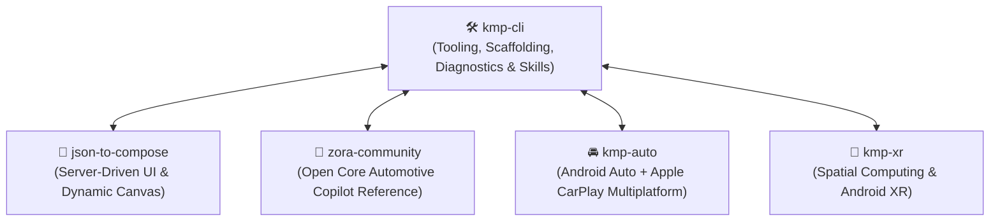

# Ecosystem & Cross-Promotion

`kmp-cli` is not an isolated tool. It is part of a cohesive family of open-source libraries and production applications designed to elevate Kotlin Multiplatform to enterprise grade.

---

## The Cohesive Architecture

---

## Member Projects

### [🎨 json-to-compose](json-to-compose.md)
* **What it does:** Declarative Server-Driven UI (SDUI) runtime for Compose Multiplatform. Renders dynamic JSON documents into reactive native Compose trees.
* **Synergy with KMP CLI:** `kmp-cli` provides the official `json-to-compose-sample-app` starter template and certified `kotlin-ui-sdui-compose` skill.

### [🚗 zora-community](zora-community.md)
* **What it does:** Standalone open-source reference application for an offline-first vehicle copilot and parts catalog.
* **Synergy with KMP CLI:** Serves as the official open-core template for `kmp kit create zora-community`, demonstrating Clean Architecture, MVI, and SQLDelight persistence.

### [🚘 kmp-auto](kmp-auto.md)
* **What it does:** Cross-platform automotive framework bridging `androidx.car.app` (Android Auto) and Apple CarPlay into a single declarative API.
* **Synergy with KMP CLI:** Provides automotive scaffolding and navigation safety templates for in-car software.

### [🥽 kmp-xr](kmp-xr.md)
* **What it does:** Spatial computing and augmented reality UI framework for Android XR and smart display glasses.
* **Synergy with KMP CLI:** Provides spatial panels and Jetpack Compose Glimmer starter templates.
