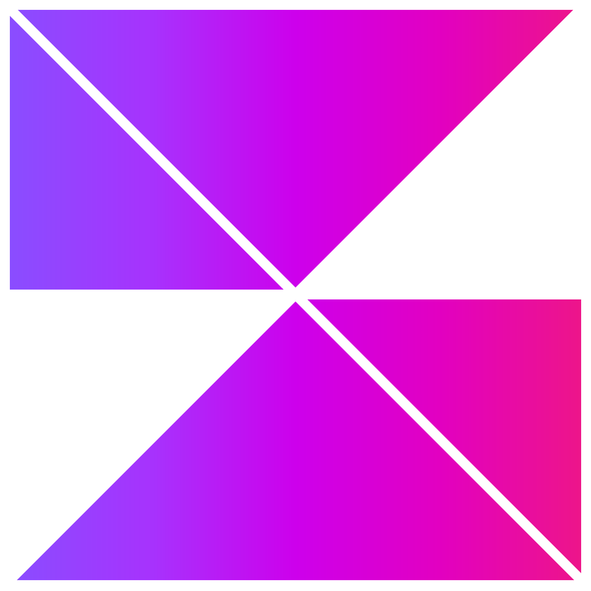
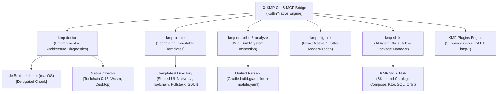

# KMP CLI & Zora Kits Hub

<div align="center">
  
  <p><em class="zora-gradient-text" style="font-size: 1.35rem;">A unified, extensible CLI and curated Agent Skills Hub for Kotlin Multiplatform — built for both human developers and AI coding agents.</em></p>
</div>

<p align="center">
  <a href="https://kotlinlang.org/docs/multiplatform.html"></a>
  <a href="https://modelcontextprotocol.io/"></a>
  <a href="https://github.com/jesusdmedinac/KMP-CLI/blob/main/LICENSE"></a>
  <a href="https://github.com/jesusdmedinac/KMP-CLI/releases"></a>
</p>

<div class="ecosystem-banner">
  <span style="font-size: 0.85rem; font-weight: 800; color: #EC168A;">Ecosystem:</span>
  <a class="ecosystem-pill" href="ecosystem/json-to-compose/">🎨 json-to-compose</a>
  <a class="ecosystem-pill" href="ecosystem/zora-community/">🚗 zora-community</a>
  <a class="ecosystem-pill" href="ecosystem/kmp-auto/">🚘 kmp-auto</a>
  <a class="ecosystem-pill" href="ecosystem/kmp-xr/">🥽 kmp-xr</a>
</div>

---

## 🎨 Zora Brand Identity & Palette

All scaffolding templates, tools, and UI components feature the official **Zora** visual system:

| Stop | Token | Hex | RGB | Role in Gradient |
| :---: | :--- | :---: | :---: | :--- |
| **0%** | `ZoraPurple` | `#894CFF` | `(137, 76, 255)` | Gradient origin / Primary accent |
| **25%** | `ZoraViolet` | `#A833FD` | `(168, 51, 253)` | Violet transition |
| **50%** | `ZoraMagenta` | `#CD00EB` | `(205, 0, 235)` | Mid-tone magenta |
| **75%** | `ZoraFuchsia` | `#E200C0` | `(226, 0, 192)` | Vibrant fuchsia |
| **100%** | `ZoraPink` | `#EC168A` | `(236, 22, 138)` | Gradient destination / High-contrast pink |

Master vector assets are available in `docs/assets/`:
- `zora-transparent.svg`: Transparent gradient icon for light and dark surfaces.
- `zora-dark.svg`: Dark mode variant (`#000000` canvas).
- `zora-white.svg`: Light mode variant (`#FFFFFF` canvas).
- `zora-colors.svg`: Horizontal brand swatch vector.

---

## 🌟 Why KMP CLI?

Inspired by the developer experience of **Google Android CLI & Android Skills**, **Flutter CLI**, and **GitHub CLI**, this project unifies environment diagnostics, project inspection, dependency auditing, project scaffolding, legacy migration, and agent-driven development into a single, cohesive open-source ecosystem.

Kotlin Multiplatform is maturing rapidly with Compose Multiplatform, Ktor, and the recent introduction of **The Kotlin Toolchain 0.12+** (`module.yaml`). However, the developer experience (DX) and AI collaboration experience remain fragmented:

1. **Fragmented Diagnostics**: Existing tools like JetBrains `kdoctor` focus exclusively on mobile setups on macOS without structured JSON output (`--json`), and are unaware of Kotlin Toolchain 0.12, Wasm web runtimes, or Desktop dependencies.
2. **Missing Agent Skills Hub**: While AI coding agents (Antigravity, Claude Code, Cursor, Copilot) are increasingly used to build and migrate KMP projects, there was **no open package manager or standard repository for KMP agent skills** (`SKILL.md`).
3. **Dual Build-System Reality**: Modern teams navigate between established Gradle setups (`build.gradle.kts`) and declarative Kotlin Toolchain projects (`module.yaml`). Tooling must understand both seamlessly.
4. **Legacy App Modernization**: Teams migrating from React Native or Flutter need an automated, Strangler Fig roadmap to transition to Compose Multiplatform without breaking existing features.

**KMP CLI (`kmp`)** bridges this gap: it serves as a high-performance native CLI companion for developers and an **AI-native bridge via Model Context Protocol (MCP)**.

---

## 🚀 Key Architectural Pillars



### Core Architecture Highlights

- **Dual Experience (Humans + AI Agents)**:
  - Rich interactive terminal UI with semantic ANSI colors, spinners, tables, and prompts via [Clikt](https://ajalt.github.io/clikt/) and [Mordant](https://ajalt.github.io/mordant/).
  - Global `--json` flag producing deterministic, schema-validated JSON outputs for AI agents and CI/CD pipelines.
- **Facade & Orchestration**:
  - Automatically detects and delegates Apple/Xcode checks to JetBrains `kdoctor` on macOS when installed.
  - Expands diagnostics to include **The Kotlin Toolchain (`./kotlin`)**, Wasm/Web toolchains, Desktop targets, and installed agent skills.
- **Dual Build-System Support**:
  - Full inspection and scaffolding support for both standard Gradle (`build.gradle.kts` with `libs.versions.toml`) and modern Kotlin Toolchain (`module.yaml`).
- **KMP Skills Hub**:
  - Open, curated repository of procedural knowledge following the open `SKILL.md` specification with YAML frontmatter.
  - Compatible with Google Antigravity, Claude Code, Cursor, and custom agent runtimes.
- **Standalone Native Performance**:
  - Built in Kotlin/Native producing standalone binaries (universal `Mach-O` for macOS arm64/x64, Linux ELF, and Windows PE) with sub-second startup times and zero JVM overhead.

---

## 📦 Quick Installation

=== "Homebrew (macOS & Linux)"
    ```bash
    brew tap jesusdmedinac/tap
    brew install kmp
    ```

=== "SDKMAN! (JVM Ecosystem)"
    ```bash
    sdk install kmp
    ```

=== "Curl One-Liner (macOS & Linux)"
    ```bash
    curl -fsSL https://raw.githubusercontent.com/jesusdmedinac/KMP-CLI/main/install.sh | bash
    ```

=== "Prebuilt Binaries"
    Download precompiled standalone binaries directly from [GitHub Releases](https://github.com/jesusdmedinac/KMP-CLI/releases):
    - **macOS Apple Silicon:** `kmp-macos-arm64.tar.gz`
    - **macOS Intel:** `kmp-macos-x64.tar.gz`
    - **Linux x64:** `kmp-linux-x64.tar.gz`
    - **Windows x64:** `kmp-windows-x64.zip`

---

## 🛠️ Command Suite Matrix

| Command | Status | Description | Human Output | AI Output (`--json`) |
| :--- | :---: | :--- | :--- | :--- |
| [`kmp doctor`](commands/doctor.md) | ✅ Available | Diagnoses host environment (JDK, Android SDK, Xcode via `kdoctor`, Toolchain 0.12, Wasm) & architecture (`--architecture`) | Checkmarks, warnings, remediation | Typed diagnostic report + commands |
| [`kmp describe`](commands/describe.md) | ✅ Available | Inspects project architecture, targets, and modules from Gradle or `module.yaml` | Hierarchy tree & summary | `ProjectDescriptor` JSON schema |
| [`kmp analyze dependencies`](commands/analyze.md) | ✅ Available | Analyzes version catalog (`libs.versions.toml`) dependencies, plugins, and versions | Formatted dependency table | `ProjectDependencies` JSON schema |
| [`kmp analyze libraries`](commands/analyze.md) | ✅ Available | Queries klibs.io catalog for target compatibility, coordinates, and licenses | Formatted compatibility table | `LibrarySearchResult` JSON schema |
| [`kmp create`](commands/create.md) | ✅ Available | Scaffolds new projects using customizable, immutable architectural templates | Success card & next steps | `ScaffoldingResult` JSON schema |
| [`kmp skills`](commands/skills.md) | ✅ Available | Package manager for agent skills (`list`, `find`, `describe`, `install`) | Formatted skills table | Machine-readable catalog & paths |
| [`kmp migrate`](commands/migrate.md) | ✅ Available | Strangler Fig modernization for React Native and Flutter codebases (`audit`, `plan`, `execute`) | Phased roadmaps & progress manifest | `MigrationExecuteResult` JSON schema |
| [`kmp mcp`](commands/mcp.md) | ✅ Available | Model Context Protocol stdio server exposing 9 native tools for AI agents | N/A | MCP JSON-RPC protocol |

---

## 💻 Interactive Usage Guide

### 1. Environment & Architecture Diagnostics (`kmp doctor`)

=== "Human Terminal"
    ```bash
    # Standard workstation health check
    kmp doctor

    # Architecture & Stage 1 Living Foundation check (Clean Architecture + Entry points)
    kmp doctor --architecture
    ```

=== "AI Agent / JSON"
    ```bash
    # Machine-readable output for CI/CD or AI agents
    kmp doctor --json
    kmp doctor --architecture --json
    ```

### 2. Project Architecture Inspection (`kmp describe`)

=== "Inspect Working Directory"
    ```bash
    kmp describe
    ```

=== "Inspect Specific Path & JSON"
    ```bash
    kmp describe path/to/project --json
    ```

### 3. Dependency & Ecosystem Analysis (`kmp analyze`)

=== "Version Catalog Audit"
    ```bash
    # Analyze default gradle/libs.versions.toml
    kmp analyze dependencies

    # Analyze with structured JSON
    kmp analyze dependencies gradle/libs.versions.toml --json
    ```

=== "klibs.io Library Query"
    ```bash
    # Search for multiplatform networking libraries
    kmp analyze libraries ktor

    # Query SQL libraries filtered by active targets
    kmp analyze libraries "sql" --targets android,ios --json
    ```

### 4. Project Scaffolding (`kmp create`)

=== "Interactive Console Wizard"
    ```bash
    # Step-by-step interactive wizard (prompts for Name, Package, UI frameworks, Targets)
    kmp create --wizard
    ```

=== "CLI Flag Scaffolding"
    ```bash
    # Shared UI app with Compose Multiplatform
    kmp create MyApp --template shared-ui --targets android,ios,desktop,wasm

    # Native UI app (Compose on Android/Desktop with native SwiftUI on iOS)
    kmp create MyNativeApp --template native-ui

    # Server-Driven UI starter powered by json-to-compose
    kmp create MySduiApp --template sdui-starter --targets android,ios

    # Declarative Kotlin Toolchain 0.12+ (module.yaml)
    kmp create MyToolchainApp --template toolchain-shared-ui
    ```

### 5. KMP Skills Hub (`kmp skills`)

=== "Catalog Discovery"
    ```bash
    # List all certified skills in the catalog
    kmp skills list

    # Search for skills by keyword
    kmp skills find compose
    ```

=== "Installation"
    ```bash
    # Install into active project (.agents/skills/<id>/SKILL.md)
    kmp skills install kotlin-ui-sdui-compose

    # Install globally (~/.kmp/skills/<id>/SKILL.md)
    kmp skills install kotlin-ui-sdui-compose --global
    ```

### 6. Native Model Context Protocol Server (`kmp mcp`)

Launch `kmp` as a native stdio Model Context Protocol (MCP) server for Claude Desktop, Cursor, Google Antigravity, and Windsurf:

```bash
kmp mcp
```

#### Client Configuration Example:
Add `kmp` to your `claude_desktop_config.json` or `.cursor/mcp.json`:
```json
{
  "mcpServers": {
    "kmp-cli": {
      "command": "kmp",
      "args": ["mcp"]
    }
  }
}
```

#### Exposed MCP Tools (9):
| MCP Tool | Description | Key Parameters |
| :--- | :--- | :--- |
| `kmp_doctor` | Host environment check (JDK, Android SDK, Xcode via `kdoctor`, Toolchain 0.12) | `includeKdoctor`, `projectPath` |
| `kmp_doctor_architecture` | Clean Architecture boundary & Stage 1 Living Foundation audit | `projectPath` |
| `kmp_describe` | Project targets, modules, and build system inspection | `projectPath` |
| `kmp_analyze_dependencies` | Dependency version catalog (`libs.versions.toml`) parsing and audit | `catalogPath`, `projectPath` |
| `kmp_analyze_libraries` | klibs.io library search and multiplatform target compatibility | `query`, `targets` |
| `kmp_list_skills` | List certified procedural skills in the KMP Skills Hub | None |
| `kmp_add_skill` | Install an agent skill locally or globally | `skillId`, `global` |
| `kmp_migrate_audit` | Audit React Native or Flutter codebases for native bridge migration | `path` |
| `kmp_migrate_plan` | Generate phased Strangler Fig migration roadmap to KMP | `path`, `pathway` |
| `kmp_migrate_execute` | Execute cross-platform modernization into KMP | `sourcePath`, `outputDir`, `package`, `pathway`, `strategy` |

### 7. Cross-Platform Modernization & Migration (`kmp migrate`)

Audit legacy cross-platform codebases (React Native, Flutter) and generate incremental Strangler Fig modernization pathways:

```bash
# 1. Audit React Native or Flutter codebase
kmp migrate audit ./legacy-app

# 2. Generate a 4-phase Strangler Fig incremental migration roadmap
kmp migrate plan ./legacy-app

# 3. Execute end-to-end migration into a clean Compose Multiplatform project
kmp migrate execute ./legacy-app --output ./migrated-kmp --package com.example.migrated --strategy autonomous
```

!!! tip "Smart Redirect"
    Running `kmp analyze` on a directory containing `package.json` (React Native) or `pubspec.yaml` (Flutter) without Kotlin build descriptors will automatically advise running `kmp migrate audit`.

---

## 📊 Live Project Roadmap & Milestones

Development follows the **5-Step AI Planning & Development Process** (Natural Language Intentions $\rightarrow$ Gherkin BDD Specs $\rightarrow$ PROGRESS.md $\rightarrow$ TDD Iteration $\rightarrow$ Atomic Commits).

### Phase 0: Foundations & Architecture ✅
- [x] Baseline multiplatform `.gitignore` and build configuration.
- [x] [RFC-001: Vision, Architecture, and Roadmap](rfcs/RFC-001-vision-and-architecture.md).
- [x] [RFC-002: Server-Driven UI Synergy with json-to-compose](rfcs/RFC-002-sdui-synergy-json-to-compose.md).
- [x] Initial BDD Feature Specifications (`01_kmp_doctor.feature` through `05_kmp_sdui_integration.feature`).

### Phase 1: MVP Core CLI & `kmp doctor` ✅
- [x] Multi-module skeleton: `kmp-core` and native `kmp-cli` with Clikt & Mordant.
- [x] Diagnostics Engine (`JdkChecker`, `KotlinToolchainChecker`, `KDoctor` wrapper).
- [x] Clikt `doctor` command with dual output (Human TUI & `--json`).
- [x] Universal macOS binary build task (`assembleReleaseExecutableMacos`).

### Phase 2: KMP Skills Hub & Management ✅
- [x] Open `SKILL.md` schema, data models & catalog serialization.
- [x] Curated seed KMP skills: `kmp-compose-adaptive`, `kmp-ktor-networking`, `kmp-sqldelight-database`, `kmp-toolchain-migration`, `kmp-coroutines-concurrency`, `kmp-cli`.
- [x] Local & Global Skills installer (`kmp skills install`, `describe`, `find`, `list`).

### Phase 3: Project Analysis, Modern Templates & Migration Engine ✅
- [x] Dual Build System Parser (`UnifiedProjectParser`, `GradleProjectParser`, `KotlinToolchainParser`).
- [x] `kmp describe` and `kmp analyze dependencies` commands.
- [x] Multiplatform Scaffolding Engine with immutable templates (`shared-ui`, `native-ui`, `toolchain-app`, `fullstack`, `sdui-starter`).
- [x] [RFC-005: Cross-Platform Modernization Engine](rfcs/RFC-005-cross-platform-modernization-and-migration.md) (`kmp migrate audit`, `plan`, `execute`).
- [x] Kotlin Foundation Grant Winners Skills Catalog ([RFC-004](rfcs/RFC-004-agent-skills-evolution-and-guard-engine.md)): Coil 3, Multiplatform-Settings, Store5, Orbit MVI, Compose Rich Editor, SKIE, Kobweb, Firebase KMP.

### Phase 4: Distribution & Ecosystem Integration 🚀 (Current)
- [x] Native Stdio Model Context Protocol (`kmp mcp`) server.
- [x] Official documentation site on GitHub Pages with Material for MkDocs.
- [x] Generative Engine Optimization (`/llms.txt`).
- [x] Universal shell installer (`install.sh`).
- [ ] Homebrew tap (`brew install kmp`) and SDKMAN! candidate publishing.
- [ ] [RFC-003: Commercial Zora KMP Kits Hub, Licensing & Copilot](rfcs/RFC-003-zora-kits-licensing-and-copilot.md).

---

## 💻 Developer Guide: Building from Source

### Prerequisites
- **Java Development Kit (JDK)**: OpenJDK 17 or 21 (required by Gradle 8.14+ and Kotlin 2.1+).
- **Host OS**: macOS (Apple Silicon `macosArm64` or Intel `macosX64`) or Linux (`linuxX64`).
- **Optional**: JetBrains `kdoctor` (`brew install kdoctor`) for delegated mobile/Xcode diagnostics.

### Running Automated Tests
Run the full verification suite across all multiplatform targets (JVM, macOS Arm64, macOS x64, Linux x64):
```bash
# Run all tests across both modules and native targets
./gradlew allTests

# Run full project checks
./gradlew check
```

### Compiling Native Binaries
```bash
# Build release executable for macOS Apple Silicon
./gradlew :kmp-cli:linkReleaseExecutableMacosArm64

# Universal macOS Binary (Apple Silicon + Intel via lipo)
./gradlew :kmp-cli:assembleReleaseExecutableMacos

# Install locally to ~/.local/bin/kmp
./gradlew installLocal
```

---

## 🤝 Contributing

We welcome contributions from Kotlin Multiplatform developers, tool authors, and AI engineers!

1. **Review RFCs**: Read and discuss [RFC-001](rfcs/RFC-001-vision-and-architecture.md), [RFC-002](rfcs/RFC-002-sdui-synergy-json-to-compose.md), [RFC-003](rfcs/RFC-003-zora-kits-licensing-and-copilot.md), and [RFC-005](rfcs/RFC-005-cross-platform-modernization-and-migration.md).
2. **Propose Feature Scenarios**: Contribute new `.feature` files in `docs/features/` defining desired CLI behavior in Gherkin syntax.
3. **Author KMP Skills**: Contribute reusable recipes and best practices formatted as `SKILL.md` for the Skills Hub.
4. **Follow BDD & TDD**: Every functional change must be anchored to an approved scenario in `docs/features/` and tracked in `PROGRESS.md`.

---

## 📄 License

This project is licensed under the [Apache License 2.0](https://github.com/jesusdmedinac/KMP-CLI/blob/main/LICENSE).
