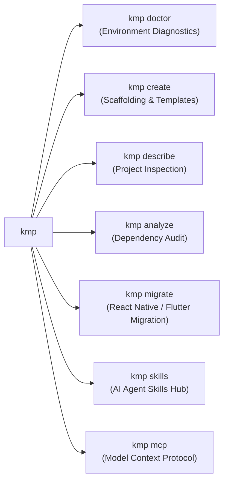

# KMP CLI & Zora Kits Hub

<div align="center">
  
  <p><em class="zora-gradient-text" style="font-size: 1.25rem;">A unified, extensible CLI and curated Agent Skills Hub for Kotlin Multiplatform — built for both human developers and AI coding agents.</em></p>
</div>

<div class="ecosystem-banner">
  <span style="font-size: 0.82rem; font-weight: 700; color: #EC168A;">Ecosystem:</span>
  <a class="ecosystem-pill" href="ecosystem/json-to-compose/">🎨 json-to-compose</a>
  <a class="ecosystem-pill" href="ecosystem/zora-community/">🚗 zora-community</a>
  <a class="ecosystem-pill" href="ecosystem/kmp-auto/">🚘 kmp-auto</a>
  <a class="ecosystem-pill" href="ecosystem/kmp-xr/">🥽 kmp-xr</a>
</div>

---

## 🌟 Why KMP CLI?

Kotlin Multiplatform is maturing rapidly with Compose Multiplatform, Ktor, and the recent introduction of **The Kotlin Toolchain 0.12+** (`module.yaml`). However, the developer experience (DX) and AI collaboration experience remain fragmented:

1. **Fragmented Diagnostics**: Existing tools focus exclusively on mobile setups on macOS without structured JSON output (`--json`), and are unaware of Kotlin Toolchain 0.12, Wasm web runtimes, or Desktop dependencies.
2. **Missing Agent Skills Hub**: While AI coding agents (Antigravity, Claude Code, Cursor, Copilot) are increasingly used to build and migrate KMP projects, there was **no open package manager or standard repository for KMP agent skills** (`SKILL.md`).
3. **Dual Build-System Reality**: Modern teams navigate between established Gradle setups (`build.gradle.kts`) and declarative Kotlin Toolchain projects (`module.yaml`). Tooling must understand both seamlessly.
4. **Legacy App Modernization**: Teams migrating from React Native or Flutter need an automated, Strangler Fig roadmap to transition to Compose Multiplatform without breaking existing features.

**KMP CLI (`kmp`)** bridges this gap: it serves as a high-performance native CLI companion for developers and an **AI-native bridge via Model Context Protocol (MCP)**.

---

## 🚀 Quick Install

=== "Homebrew (macOS & Linux)"
    ```bash
    brew tap jesusdmedinac/tap
    brew install kmp
    ```

=== "SDKMAN! (JVM Ecosystem)"
    ```bash
    sdk install kmp
    ```

=== "Curl One-Liner"
    ```bash
    curl -fsSL https://raw.githubusercontent.com/jesusdmedinac/KMP-CLI/main/install.sh | bash
    ```

---

## 🔍 Core Capabilities at a Glance



- **`kmp doctor`**: Checks host environment health across Android SDK, JDK, Xcode, CocoaPods, and Wasm toolchains with human-friendly and `--json` outputs.
- **`kmp create`**: Scaffolds clean, zero-bloat Kotlin Multiplatform projects with targeted runners (`shared-ui`, `native-ui`, `fullstack`, `json-to-compose-sample-app`).
- **`kmp describe`**: Parses and reports build system configurations, compiler versions, and target platforms across both Gradle and `module.yaml`.
- **`kmp analyze dependencies`**: Audits project dependencies and version catalogs, mapping legacy coordinates to official KMP equivalents.
- **`kmp migrate`**: Automatically audits legacy React Native and Flutter projects, plans phased Strangler Fig roadmaps, and synthesizes Compose Multiplatform apps.
- **`kmp skills`**: The open package manager for certified `SKILL.md` runbooks, empowering AI agents to adhere to Kotlin Multiplatform best practices.
- **`kmp mcp`**: A native Model Context Protocol server exposing project analysis and doctor diagnostics directly to AI coding agents.
