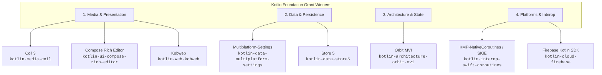

# Strategic Plan: Kotlin Foundation Grant Winners Skills Integration in `kmp-cli`

## Executive Summary

The **Kotlin Foundation Grants Program** identifies, funds, and accelerates the most critical open-source libraries across the Kotlin Multiplatform (KMP) ecosystem. Developers building production KMP applications frequently choose these grant-winning libraries for image rendering, caching, key-value storage, state architecture, rich text editing, Swift interop, web presentation, and cloud backends.

This plan details how `kmp-cli` will curate, package, and provide certified **Agent Skills** (`SKILL.md` adhering to the `agentskills.io` standard) for each official Kotlin Foundation Grant Winner library. By embedding these skills into `kmp-cli`, both AI coding assistants (Antigravity, Claude, Cursor) and human engineers will gain access to vetted multiplatform architecture recipes, dependency coordinates, and strict boundary hygiene directives.

---

## 1. Vision & Architectural Principles

### 1.1 Goals
1. **Canonical Authority**: Every skill reflects the latest multiplatform idioms (Kotlin 2.1+, Compose Multiplatform 1.7+, Kotlin Toolchain `module.yaml` and Gradle KTS).
2. **Zero-Bloat & Boundary Hygiene**: Strict separation of concerns — purely multiplatform abstractions in `commonMain`, with platform-specific engines encapsulated cleanly.
3. **Agentic Discoverability**: Each skill contains trigger phrases, structured frontmatter, compatibility matrices, and anti-pattern checklists to guide autonomous coding agents.
4. **Seamless CLI Integration**: Accessible via `kmp skills search`, `kmp skills install`, and `kmp analyze libraries`.

### 1.2 Hierarchy of Canonical Truth
In alignment with the KMP CLI Plugin governance:
- **Tier 1 (Contextual Truth)**: The target project's build files (`build.gradle.kts` / `module.yaml`, declared targets).
- **Tier 2 (Canonical Authority)**: Official Kotlin Foundation ecosystem guidelines, klibs.io metadata, and library author documentation.
- **Tier 3 (Procedural Runbooks)**: The certified `SKILL.md` recipes in `skills/<skill-id>/SKILL.md`.

---

## 2. Grant Winners Skills Inventory & Taxonomy

The 8 primary grant-winning libraries from 2023–2025 are organized into four functional domains:



---

## 3. Detailed Skill Specifications

### 3.1 `kotlin-media-coil` (Coil 3)
- **Grant Year**: 2023
- **Primary Maintainer**: Colin White
- **Canonical Coordinates**: `io.coil-kt.coil3:coil-compose`, `io.coil-kt.coil3:coil-network-ktor3`
- **Target Platforms**: Android, iOS, Desktop (JVM), Web (WasmJs, JS)
- **Core Recipe**:
  - Image loader configuration in `commonMain` using `AsyncImage` and `SubcomposeAsyncImage`.
  - Multiplatform network engine integration with Ktor 3 (`KtorNetworkFetcherFactory`).
  - Cross-platform disk caching with `okio` filesystem integration (`FileSystem.SYSTEM_TEMPORARY_DIRECTORY`).
- **Anti-Patterns**:
  - *Never* use Android-only `AndroidUri` or `context` directly in `commonMain` composables.
  - *Never* block the UI thread with synchronous image decoding.

### 3.2 `kotlin-data-multiplatform-settings` (Multiplatform-Settings)
- **Grant Year**: 2024
- **Primary Maintainer**: Russell Wolf
- **Canonical Coordinates**: `com.russhwolf:multiplatform-settings`, `com.russhwolf:multiplatform-settings-coroutines`
- **Target Platforms**: Android, iOS, Desktop (JVM), Web (JS/WasmJs)
- **Core Recipe**:
  - Factory pattern providing `ObservableSettings` across targets:
    - Android: `SharedPreferencesSettings` / `DataStoreSettings`.
    - iOS: `NSUserDefaultsSettings`.
    - Desktop: `PreferencesSettings` (Java Preferences API).
    - Web: `StorageSettings` (Browser LocalStorage).
  - Reactive Flow subscriptions using `getIntFlow`, `getStringOrNullFlow`.
- **Anti-Patterns**:
  - Do not use for large relational datasets (direct agents to `kotlin-data-room-kmp` or `kotlin-data-sqldelight-database` instead).
  - Never store unencrypted auth tokens or cryptographic keys in standard settings (delegate to platform keychain/keystore).

### 3.3 `kotlin-data-store5` (Store 5)
- **Grant Year**: 2024
- **Primary Maintainer**: Mobile Native Foundation (Mike Nakhimovich)
- **Canonical Coordinates**: `org.mobilenativefoundation.store:store5`
- **Target Platforms**: Android, iOS, Desktop, WasmJs
- **Core Recipe**:
  - Offline-first single-source-of-truth orchestration.
  - Composing `Fetcher.of { key -> ktorClient.fetch(key) }` with `SourceOfTruth.of(reader = { key -> sqldelight.select(key) }, writer = { key, data -> sqldelight.insert(key, data) })`.
  - Consuming `store.stream(StoreReadRequest.cached(key, refresh = true))` with typed `StoreReadResponse.Data`, `Loading`, and `Error`.
- **Anti-Patterns**:
  - Bypassing the local cache for hot UI updates.
  - Mixing networking error handling directly inside the UI layer.

### 3.4 `kotlin-architecture-orbit-mvi` (Orbit MVI)
- **Grant Year**: 2024
- **Primary Maintainer**: Mikolaj Leszczynski / Babylon Health
- **Canonical Coordinates**: `org.orbit-mvi:orbit-core`, `org.orbit-mvi:orbit-compose`
- **Target Platforms**: Android, iOS, Desktop, WasmJs
- **Core Recipe**:
  - `ContainerHost<STATE, SIDE_EFFECT>` pattern coupled with `androidx.lifecycle.ViewModel`.
  - Declarative state transformations: `intent { reduce { state.copy(...) } }`.
  - Non-persistent one-off event dispatch: `postSideEffect(ToastEvent)`.
  - Deterministic testing harness using `containerHost.test(initialState) { runIntent { ... } expectState { ... } }`.
- **Anti-Patterns**:
  - Firing side-effects directly inside `reduce` blocks (must remain pure).
  - Storing navigation state directly in the MVI state instead of delegating to the router.

### 3.5 `kotlin-ui-compose-rich-editor` (Compose Rich Editor)
- **Grant Year**: 2024
- **Primary Maintainer**: Mohamed Rejeb
- **Canonical Coordinates**: `com.mohamedrejeb.richeditor:richeditor-compose`
- **Target Platforms**: Android, iOS, Desktop, Web
- **Core Recipe**:
  - Managing styled text through `rememberRichTextState()`.
  - Providing toolbar controls (bold, italic, strikethrough, bullet points, headers, inline code).
  - Bi-directional export/import: HTML (`state.toHtml()`, `state.setHtml(...)`) and Markdown (`state.toMarkdown()`).
- **Anti-Patterns**:
  - Reinventing custom span parsers with platform `SpannableStringBuilder`.
  - Mutating rich text state outside the Compose snapshot system.

### 3.6 `kotlin-interop-swift-coroutines` (KMP-NativeCoroutines & SKIE)
- **Grant Year**: 2023 (KMP-NativeCoroutines by Rick Clephas) & 2024 (SKIE by Touchlab)
- **Canonical Coordinates**: `co.touchlab.skie:skie-gradle-plugin` / `com.rickclephas.kmp.nativecoroutines`
- **Target Platforms**: iOS, macOS, watchOS, tvOS
- **Core Recipe**:
  - Seamless Swift modern concurrency bridging: mapping Kotlin `StateFlow<T>` directly to Swift `AsyncSequence` and SwiftUI `@Observable`.
  - Bridging Kotlin sealed interfaces to exhaustive Swift enums.
  - Proper cancellation propagation from Swift `Task` to Kotlin `Job`.
- **Anti-Patterns**:
  - Forcing iOS engineers to write manual completion handlers or memory-leaking closures.
  - Ignoring Kotlin Coroutine cancellation when iOS view controllers dismiss.

### 3.7 `kotlin-web-kobweb` (Kobweb)
- **Grant Year**: 2025
- **Primary Maintainer**: David Herman (Varabyte)
- **Canonical Coordinates**: `com.varabyte.kobweb:kobweb-core`, `com.varabyte.kobweb:kobweb-silk`
- **Target Platforms**: Web (WasmJs, JS)
- **Core Recipe**:
  - Full-stack Compose HTML development with file-based routing (`@Page`).
  - Responsive design tokens with Silk UI (`Breakpoint`, `Modifier.fillMaxWidth()`).
  - Server-side API endpoints (`@Api`) and static site export.
- **Anti-Patterns**:
  - Mixing Android/Desktop Skiko Compose dependencies in Kobweb DOM modules.
  - Hardcoding absolute viewport dimensions instead of responsive Silk breakpoints.

### 3.8 `kotlin-cloud-firebase` (Firebase Kotlin SDK)
- **Grant Year**: 2025
- **Primary Maintainer**: GitLive
- **Canonical Coordinates**: `dev.gitlive:firebase-firestore`, `dev.gitlive:firebase-auth`, `dev.gitlive:firebase-storage`
- **Target Platforms**: Android, iOS, Desktop, Web
- **Core Recipe**:
  - Idiomatic multiplatform Firebase client without platform-specific SDK leaks.
  - Coroutine-based document queries: `Firebase.firestore.collection("users").document("id").snapshots`.
  - Kotlinx Serialization integration for automatic document decoding: `doc.data<UserProfile>()`.
- **Anti-Patterns**:
  - Calling Google Play Services `Task.await()` in `commonMain`.
  - Writing raw Map/JSON parsing instead of `@Serializable` data classes.

---

## 4. Engineering Deliverables & Implementation Phases

The integration will be delivered across four structured phases:

| Phase | Scope | Target Skills | Deliverables |
| :--- | :--- | :--- | :--- |
| **Phase 1: Persistence & Media** | High-frequency baseline needs for mobile and desktop apps | `kotlin-data-multiplatform-settings`<br/>`kotlin-media-coil`<br/>`kotlin-data-store5` | - 3 `SKILL.md` documents<br/>- Entries in `skills/catalog.json`<br/>- Entries in `DefaultSkillsCatalog.kt`<br/>- Unit tests in `SeedSkillsValidationTest` |
| **Phase 2: Architecture & Rich UI** | State management and text editing capabilities | `kotlin-architecture-orbit-mvi`<br/>`kotlin-ui-compose-rich-editor` | - 2 `SKILL.md` documents<br/>- Catalog synchronization<br/>- Sample usage tests |
| **Phase 3: Swift Interop & Cloud** | Native iOS ergonomics, web expansion, and BaaS | `kotlin-interop-swift-coroutines`<br/>`kotlin-web-kobweb`<br/>`kotlin-cloud-firebase` | - 3 `SKILL.md` documents<br/>- Multiplatform interop recipes<br/>- Catalog synchronization |
| **Phase 4: CLI Enhancement** | Discovery and automatic curation | CLI features | - Add `--tag grant-winner` filter to `kmp skills list`<br/>- Visual badge `[GRANT WINNER]` in `kmp skills search`<br/>- Automatic recommendation in `kmp analyze libraries` |

---

## 5. Catalog Schema & Metadata Specification

Each skill will be registered in `skills/catalog.json` and `DefaultSkillsCatalog.kt` using this schema:

```json
{
  "id": "kotlin-media-coil",
  "name": "kotlin-media-coil",
  "description": "Multiplatform async image loading, caching, and Ktor 3 integration with Coil 3 for Compose Multiplatform.",
  "version": "1.0.0",
  "author": "jesusdmedinac",
  "category": "media",
  "aliases": [
    "kmp-coil",
    "coil3"
  ],
  "tags": [
    "coil",
    "images",
    "media",
    "cache",
    "grant-winner"
  ],
  "targets": [
    "android",
    "ios",
    "desktop",
    "wasm"
  ],
  "path": "skills/kotlin-media-coil/SKILL.md"
}
```

---

## 6. Verification & Quality Assurance

To ensure that each integrated skill meets the highest standards:
1. **Frontmatter & Markdown Linting**: Ensure each `SKILL.md` parses cleanly via `SkillParser.kt`.
2. **Catalog Integrity Test**: Extend `SeedSkillsValidationTest.kt` to assert the presence of all 8 grant-winner IDs, aliases, and tags (`grant-winner`).
3. **Target Compatibility**: Cross-reference dependency coordinates and compatibility matrices against `klibs.io` API.
4. **Zero-Bloat Verification**: Ensure sample snippets compile under both standard Gradle KTS and declarative `module.yaml`.

---

## 7. Open Questions & Prioritization

> [!NOTE]
> Review the following strategic decisions before kickoff:

1. **Phase 1 Prioritization**: Would you prefer starting immediately with **Phase 1** (`multiplatform-settings`, `coil3`, `store5`), or should we prioritize Swift interop (`SKIE / KMP-NativeCoroutines`) first?
2. **Naming Convention**: Do you approve the `kotlin-<category>-<library>` standard (e.g. `kotlin-media-coil`, `kotlin-data-multiplatform-settings`), with short aliases (e.g. `coil`, `settings`) for fast CLI invocation?
3. **CLI Badging**: Should `kmp skills list` and `kmp analyze libraries` explicitly flag libraries as `[Kotlin Foundation Grant Winner]` in terminal outputs?
